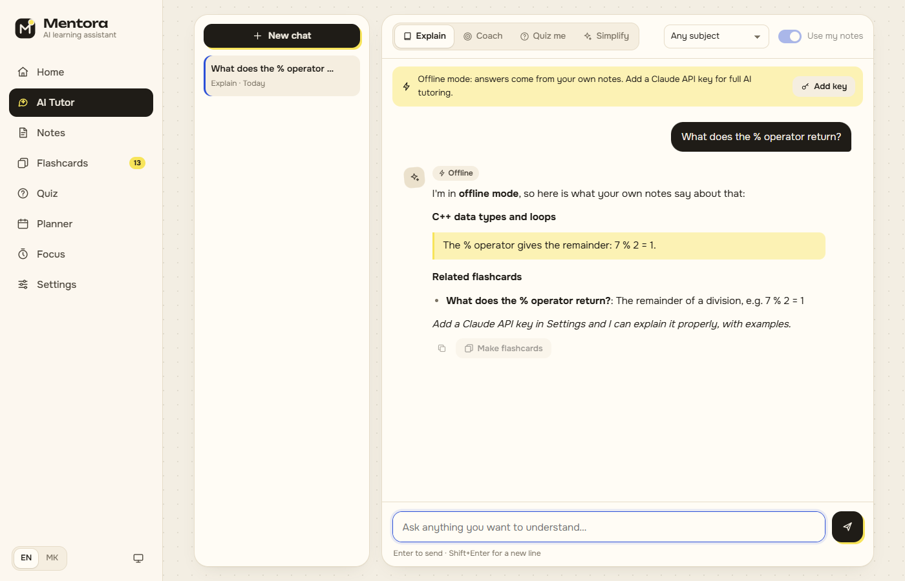
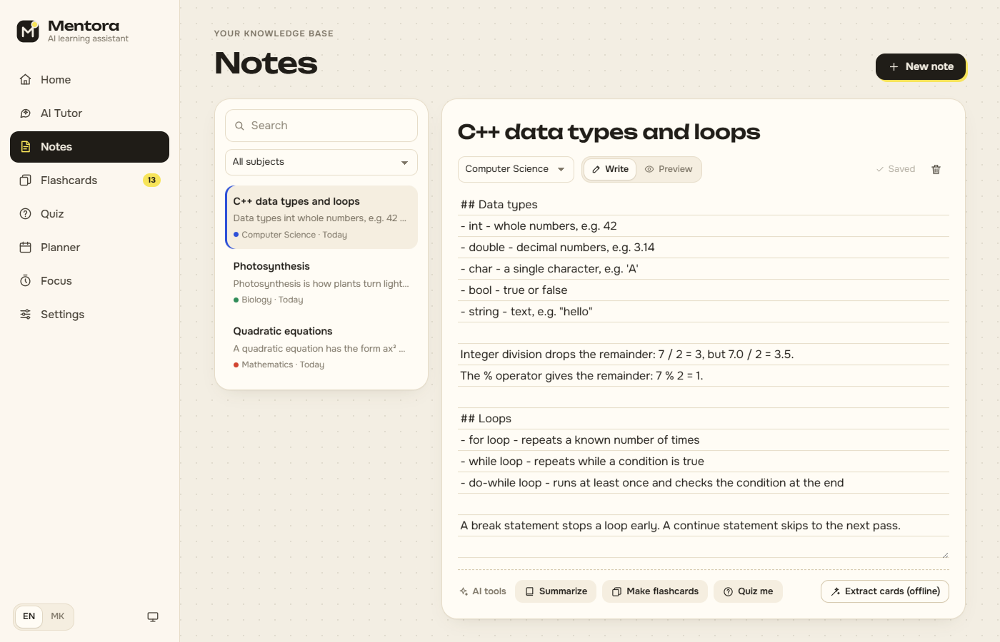
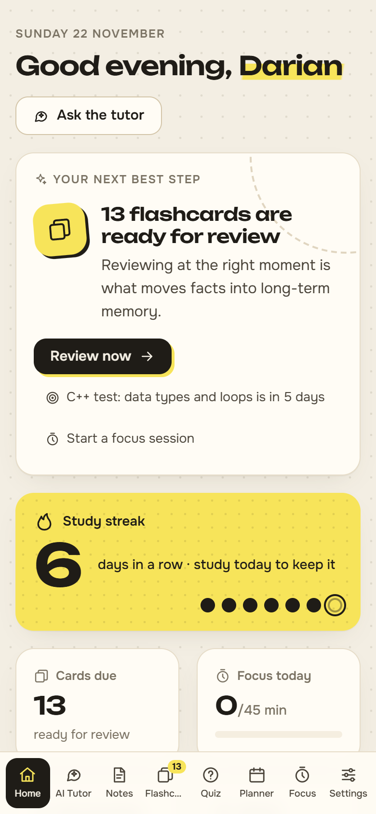

# Mentora: project report

This report goes with Mentora, my AI Personal Learning Assistant. It covers the six points the assignment asks for: the topic and purpose, the AI tools I used, examples of my prompts, the results and my own contribution, a reflection on AI, and an acknowledgement of AI use.

## 1. Topic and purpose

**Topic:** AI Personal Learning Assistant, which I chose from a list of 10 project topics. The project was meant to be *vibecoded*, which means building it by describing what I want to an AI and guiding it, instead of typing the code myself.

**Purpose:** Mentora is a study app for students. It combines an AI tutor with the tools a student needs every day: notes, flashcards that use spaced repetition, quizzes, a study planner and a focus timer. The goal is to help a student actually remember what they learn, not just get answers. That's why the tutor has a *Coach* mode that asks questions instead of giving the answer straight away.

I wanted it to:

- open by double-clicking `index.html`, with nothing to install
- work for free: everything except the AI features works offline, without an API key
- be in English and Macedonian, with a switch between them

## 2. AI tools I used

| Tool | Made by | What it was used for |
|---|---|---|
| **Claude Code** in the Claude desktop app, running the model **Claude Opus 5.5** | Anthropic | Planned and wrote all of Mentora's code, wrote and ran the automated tests, fixed the bugs they found, wrote the README, took the screenshots and created the GitHub repository. It also drafted my essay *AI in Everyday Life* and this report. |
| **Claude API** (Claude Opus 5.5, Claude Sonnet 5.5 and Claude Haiku 5.5) | Anthropic | The AI inside Mentora: the tutor chat, note summaries, AI-made flashcards and quizzes, and AI study plans. It only runs when the user adds their own API key. |

## 3. Examples of my prompts

The prompts are copied exactly as I typed them.

**Starting the project**

> okay but wait now. i will need to create anothe repo and another project which is supposed to be vibecoded and another homework for the same teacher which will be in another repo and at the end i will send them both to her. I yet again got 10 topics for the project and i chose this one : AI Personal Learning Assistant. So you should make this make it the best possible but in another repo. Take as long as needed no rush.

Before writing any code, Claude asked me three multiple-choice questions. My answers were:

| Claude's question | My answer |
|---|---|
| What kind of app should it be? | **Web app** |
| How should the AI work? | **Optional Claude key**, so all the non-AI features work without one |
| Which language? | **Both with a switch** (English and Macedonian) |

Claude then built the whole app, tested it in Chrome and pushed it to a new private GitHub repository.

**Testing**

> okay before i send this to her i yet again will need to write an essay and i will tell you when i am finished with the essay but for now how do i test it?

Claude replied with a checklist for testing every page, how to connect my own API key, and how to open the app the way my teacher will (by downloading the ZIP from GitHub).

**The essay**

> okay can you also help me write the essay on the topic AI in everyday life.

Claude read my first essay (for my OmniCalc project) to match its length and style, then drafted *AI in Everyday Life*.

**This report**

> okay and also do these in this repo

I attached a screenshot of the assignment's requirements. Claude wrote this report, took the screenshots below and added them to the repository.

## 4. Results

### What was built

- About 5,350 lines of HTML, CSS and JavaScript in 18 files, not counting the official Anthropic library bundled in `vendor/`.
- 8 pages: Home, AI Tutor, Notes, Flashcards, Quiz, Planner, Focus and Settings. The [README](README.md) describes every feature.
- All text in both English and Macedonian, a light and a dark theme, and a layout for phones.
- No server and no build step. All data is saved in the browser.

### Testing

Claude wrote an automated test with **121 checks** that opens Mentora in Chrome, clicks through every page and checks the results. All 121 pass.

To test the AI features without spending money, the test replaced Claude's answers with simulated ones. One check did contact Anthropic's real servers with a fake key, to prove the app can reach them when it is opened by double-clicking. Real AI answers with a real key have not been tested yet.

The tests and screenshots found real problems, which were then fixed. For example:

- Dates showed in English even with Macedonian selected, because Chrome doesn't include Macedonian month and day names. Mentora now has its own.
- The offline tutor didn't find "хлорофилот" when the notes said "хлорофил", because Macedonian adds endings to words. The search now matches the beginning of words instead.
- In dark mode, the highlighted name on the home page was hard to read, and the label for the daily goal was hidden behind the chart's bars.

### Screenshots

| | |
|---|---|
|  Home: the next best step, study streak and weekly chart |  The same page in Macedonian with the dark theme |
|  The tutor without an API key, answering from my notes |  Notes with the AI tools |
|  Flashcard review: each button shows when the card comes back |  Quiz result with the mistakes to review |
|  Planner: review sessions spread out before each exam |  The phone layout |

## 5. My contribution

Mentora was vibecoded, so I did not type the code myself. Claude Code wrote the code, the tests and the documentation. My part was:

- choosing the topic from the list of ten
- making the main design decisions when Claude asked: a web app, the AI as an optional extra so the app works for free, and two languages
- setting the requirements: a separate repository, the best quality possible, and no time pressure
- directing the work after that: how to test it, the essay and this report
- deciding what goes into the repository and handing in the project

## 6. Reflection: advantages and limitations of AI

**Advantages**

- **Speed.** A complete app with 8 pages, two languages and 121 tests was made in one session. By hand it would have taken me months.
- **It knows things I haven't learned yet.** Mentora uses techniques I can now study in real code, like the SM-2 spaced-repetition algorithm, streaming answers from an AI, and plural rules for Macedonian ("1 картичка" but "5 картички").
- **It checked its own work.** The tests and screenshots found bugs before I ever opened the app.
- **It asked before guessing.** The three questions at the start meant the app was built the way I wanted.

**Limitations**

- **The first version wasn't perfect.** Some bugs only showed up in testing, so code written by AI still has to be checked like any other code.
- **AI can be confidently wrong.** That's also true for the tutor inside Mentora. It's one reason the tutor can answer from my own notes, and why Coach mode makes students think for themselves.
- **Some things it couldn't do.** Claude wasn't allowed to use a real API key, so testing real AI answers is up to me.
- **Cost and internet.** The AI features need an internet connection and an API key that costs money for every request.
- **Understanding.** I didn't write the code, so to really own it I have to read it and understand it. With AI it's easy to end up with a working app you can't explain.

## 7. Acknowledgement of AI use

This project was made with AI tools. All of Mentora's code, its tests, the README and the first draft of this report were written by **Claude Code** (Anthropic, model Claude Opus 5.5), following my instructions and decisions. The first draft of my essay *AI in Everyday Life* was also written with Claude. The AI features inside the app use the **Claude API** from Anthropic, and the app includes Anthropic's official SDK in `vendor/` under the Apache 2.0 license.
