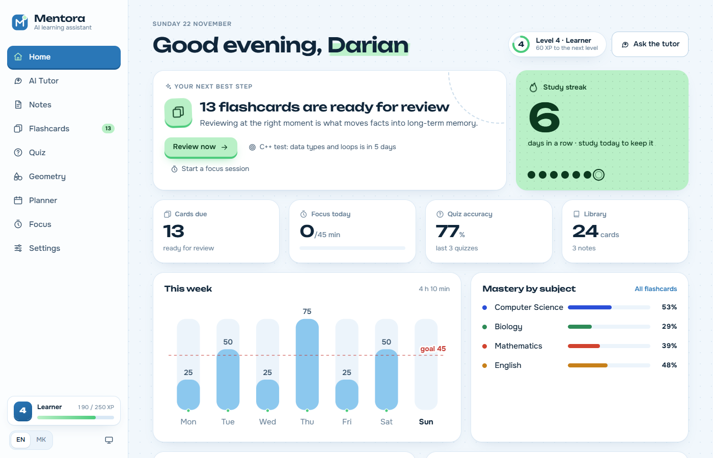
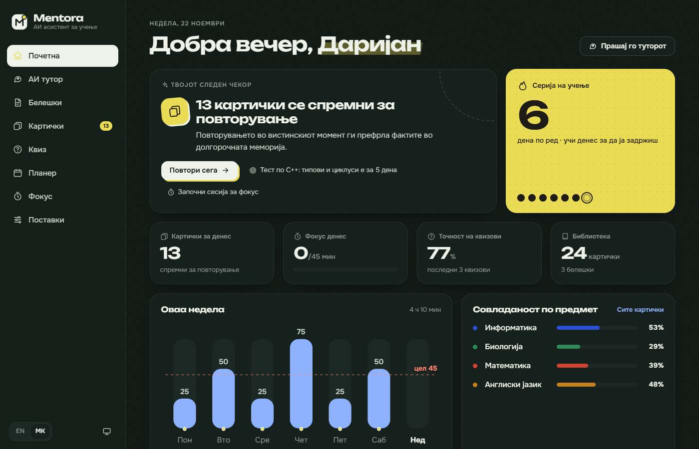
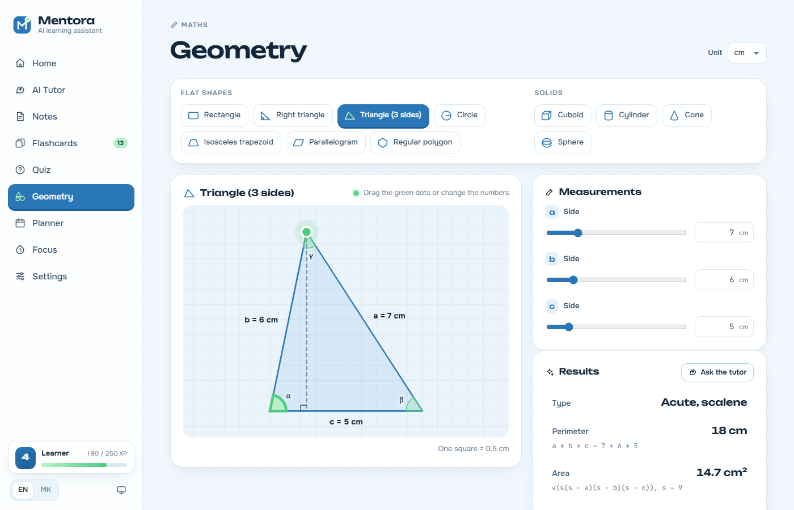
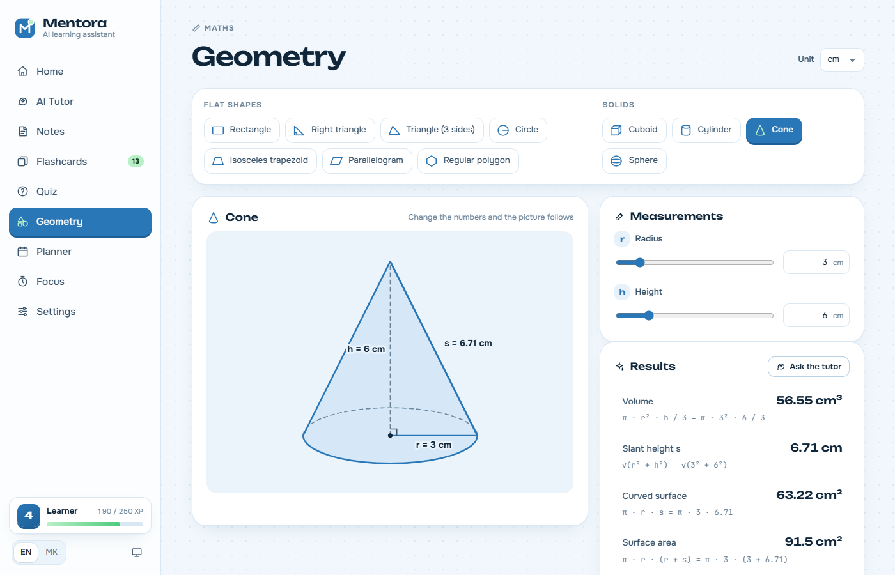
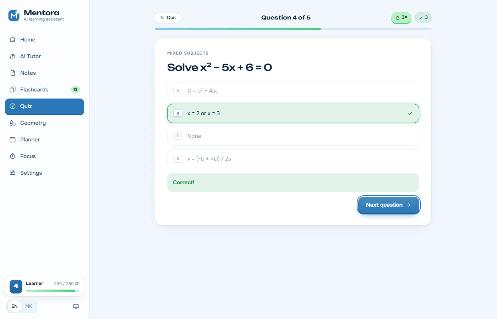
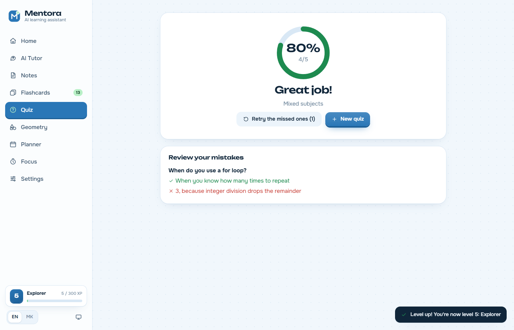
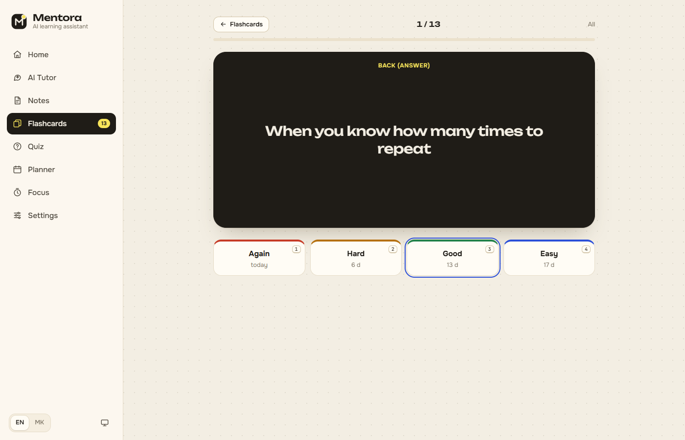
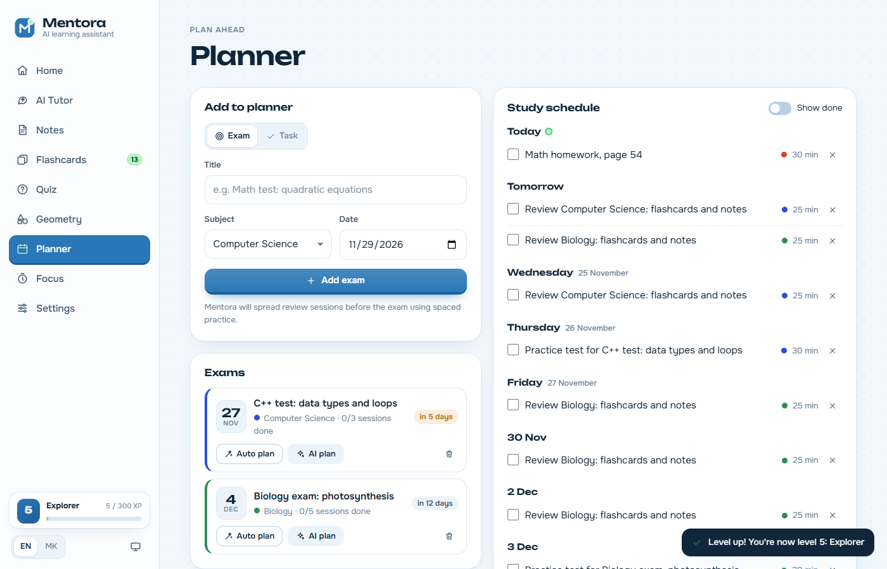

# Mentora: project report

This report goes with Mentora, my AI Personal Learning Assistant. It covers the six points the assignment asks for: the topic and purpose, the AI tools I used, examples of my prompts, the results and my own contribution, a reflection on AI, and an acknowledgement of AI use.

## 1. Topic and purpose

**Topic:** AI Personal Learning Assistant, which I chose from a list of 10 project topics. The project was meant to be *vibecoded*, which means building it by describing what I want to an AI and guiding it, instead of typing the code myself.

**Purpose:** Mentora is a study app for students. It combines an AI tutor with the tools a student needs every day: notes, flashcards that use spaced repetition, quizzes, a geometry calculator, a study planner and a focus timer. The goal is to help a student actually remember what they learn, not just get answers, and to make studying satisfying enough that they don't lose focus. That's why the tutor has a *Coach* mode that asks questions instead of giving the answer straight away, and why every bit of studying earns XP.

I wanted it to:

- open by double-clicking `index.html`, with nothing to install
- work for free: everything except the AI features works offline, without an API key
- be in English and Macedonian, with a switch between them
- look clean and calm, in white and glacier blue, with light green marking the places a student should look

## 2. AI tools I used

| Tool | Made by | What it was used for |
|---|---|---|
| **Claude Code** in the Claude desktop app, running the model **Claude Opus 5.5** | Anthropic | Planned and wrote all of Mentora's code, wrote and ran the automated tests, fixed the bugs they found, wrote the README, took the screenshots and created the GitHub repository. It also wrote my essay *AI in Everyday Life* and this report from my instructions. |
| **Claude API** (Claude Opus 5.5, Claude Sonnet 5.5 and Claude Haiku 5.5) | Anthropic | The AI inside Mentora: the tutor chat, note summaries, AI-made flashcards and quizzes, and AI study plans. It only runs when the user adds their own API key. |

## 3. Examples of my prompts

I wrote my prompts quite informally, so these are cleaned up for spelling and wording. The meaning of each one is the same as what I asked.

**Starting the project**

> Make an AI Personal Learning Assistant as my vibecoded project, in a new repository. Make it the best it can be, and take as long as you need.

Before writing any code, Claude asked me three multiple-choice questions. My answers were:

| Claude's question | My answer |
|---|---|
| What kind of app should it be? | **Web app** |
| How should the AI work? | **Optional Claude key**, so all the non-AI features work without one |
| Which language? | **Both with a switch** (English and Macedonian) |

Claude then built the whole app, tested it in Chrome and pushed it to a new private GitHub repository.

**Testing**

> Before I send the project to my teacher, how do I test the app?

Claude replied with a checklist for testing every page, how to connect my own API key, and how to open the app the way my teacher will (by downloading the ZIP from GitHub).

**The new design and features**

> Change up the design by making the primary colors white and glacier blue and patches of light green where the student should look, also make it more satisfying so students don't lose focus as easily, make a section for maths for geometry where students can calculate stuff and it directly changes in the picture.

Claude recoloured the whole app, added XP, levels and celebrations, and built the Geometry page.

**This report**

> Also cover these requirements in the repository.

I attached a screenshot of the assignment's requirements. Claude wrote this report, took the screenshots below and added them to the repository.

## 4. Results

### What was built

- About 6,900 lines of HTML, CSS and JavaScript in 22 files, not counting the official Anthropic library bundled in `vendor/`.
- 9 pages: Home, AI Tutor, Notes, Flashcards, Quiz, Geometry, Planner, Focus and Settings. The [README](README.md) describes every feature.
- **Geometry:** 11 shapes, 7 flat ones and 4 solids. You change a measurement with a slider or a number, or drag the green dots on the picture, and the drawing, the labels and every result change straight away. Each result shows its formula with your numbers in it, and pointing at a result lights up that part of the picture in green.
- **Rewards:** XP for every card, quiz answer, focus minute, finished task and tutor question, with levels and ranks from Beginner to Genius. Streaks of right answers give combo bonuses, and finishing a session, getting a high quiz score, reaching the daily goal or levelling up sets off confetti and a short sound. Sounds can be turned off in Settings.
- All text in both English and Macedonian, a light and a dark theme, and a layout for phones.
- No server and no build step. All data is saved in the browser.

### Testing

Claude wrote two automated tests with **187 checks** between them, 121 for the original app and 66 for the new design, XP and geometry. They open Mentora in Chrome, click through every page and check the results. All 187 pass. The geometry checks compare the results with values worked out by hand, for example a 3, 4, 5 triangle being right-angled and a sphere with r = 4 having a volume of 268.08.

To test the AI features without spending money, the test replaced Claude's answers with simulated ones. One check did contact Anthropic's real servers with a fake key, to prove the app can reach them when it is opened by double-clicking. Real AI answers with a real key have not been tested yet.

The tests and screenshots found real problems, which were then fixed. For example:

- Dates showed in English even with Macedonian selected, because Chrome doesn't include Macedonian month and day names. Mentora now has its own.
- The offline tutor didn't find "хлорофилот" when the notes said "хлорофил", because Macedonian adds endings to words. The search now matches the beginning of words instead.
- On the Geometry page, labels on the left and right edges of the picture were cut off, and on phones the shape buttons filled the whole first screen. Both were fixed after Claude looked at the screenshots.

### Screenshots

| | |
|---|---|
|  Home: level, streak, next best step and weekly chart |  The same page in Macedonian with the dark theme |
|  Geometry: a triangle from three sides, with angle α lit up |  Geometry: a cone, one of the four solids |
|  A quiz with a 3× combo for three right answers in a row |  Quiz result with the mistakes to review |
|  Flashcard review: each button shows when the card comes back |  The tutor without an API key, answering from my notes |
|  Planner: review sessions spread out before each exam |  Notes with the AI tools |
|  The phone layout | |

## 5. My contribution

Mentora was vibecoded, so I did not type the code myself. Claude Code wrote the code, the tests and the documentation. My part was:

- choosing the topic from the list of ten
- making the main decisions when Claude asked: a web app, the AI as an optional extra so the app works for free, and two languages
- setting the requirements: a separate repository, the best quality possible, and no time pressure
- telling Claude what features to add and how the assistant should look: white and glacier blue with light green where the student should look, a more satisfying feel so students don't lose focus, and a geometry section where the picture changes as you calculate
- telling Claude how the structure of my essay should look
- directing the rest of the work, like how to test it and this report, and deciding what goes into the repository and handing in the project

## 6. Reflection: advantages and limitations of AI

**Advantages**

- **Speed.** A complete app with 9 pages, two languages and 187 tests was made in a single day. A full redesign plus a new geometry page took one prompt. By hand it would have taken me months.
- **It knows things I haven't learned yet.** Mentora uses techniques I can now study in real code, like the SM-2 spaced-repetition algorithm, the law of cosines and Heron's formula for triangles, and plural rules for Macedonian ("1 картичка" but "5 картички").
- **It checked its own work.** The tests and screenshots found bugs before I ever opened the app.
- **It asked before guessing.** The three questions at the start meant the app was built the way I wanted.

**Limitations**

- **The first version wasn't perfect.** Some bugs only showed up in testing, so code written by AI still has to be checked like any other code.
- **AI can be confidently wrong.** That's also true for the tutor inside Mentora. It's one reason the tutor can answer from my own notes, and why Coach mode makes students think for themselves.
- **Some things it couldn't do.** Claude wasn't allowed to use a real API key, so testing real AI answers is up to me.
- **Cost and internet.** The AI features need an internet connection and an API key that costs money for every request.
- **Understanding.** I didn't write the code, so to really own it I have to read it and understand it. With AI it's easy to end up with a working app you can't explain.

## 7. Acknowledgement of AI use

This project was made with AI tools. All of Mentora's code, its tests, the README and this report were written by **Claude Code** (Anthropic, model Claude Opus 5.5), following my instructions and decisions. My essay *AI in Everyday Life* was also written with Claude, following my instructions for its structure. The AI features inside the app use the **Claude API** from Anthropic, and the app includes Anthropic's official SDK in `vendor/` under the Apache 2.0 license.
